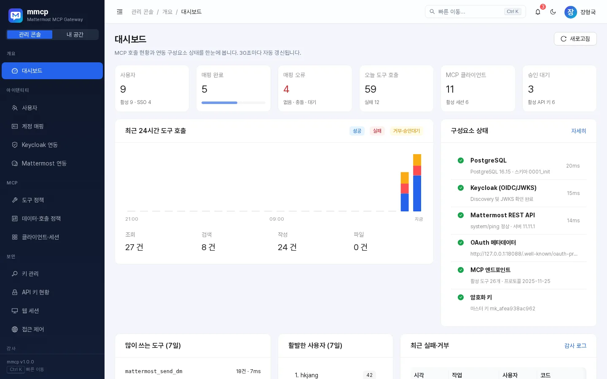
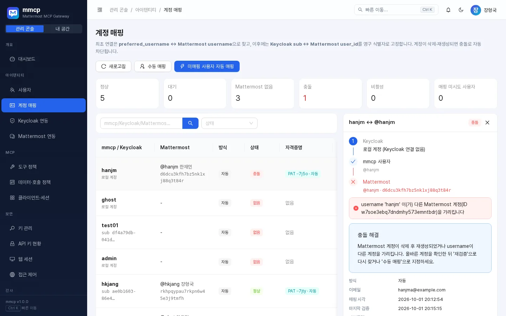
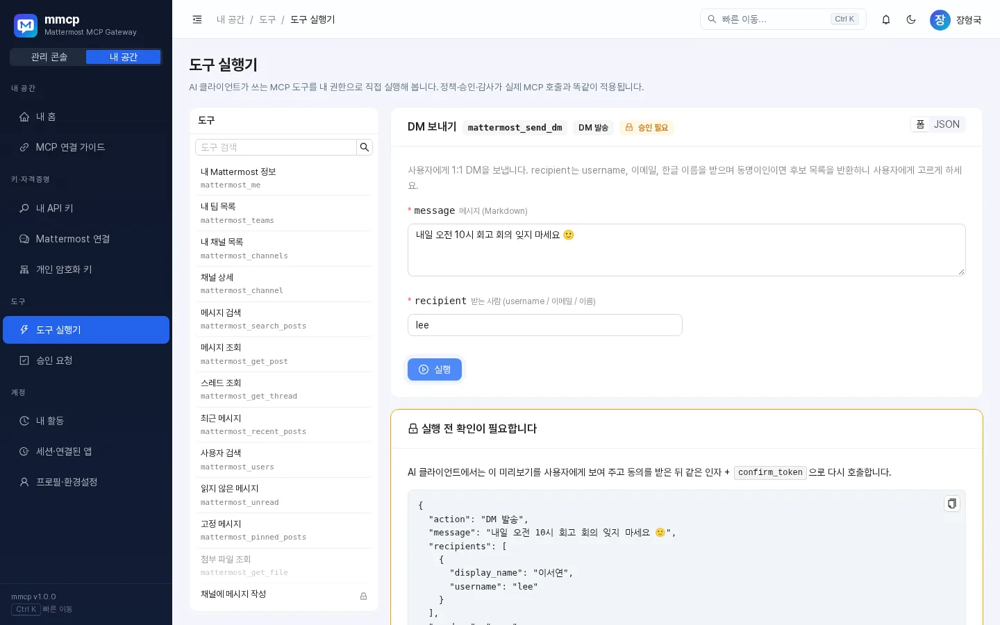
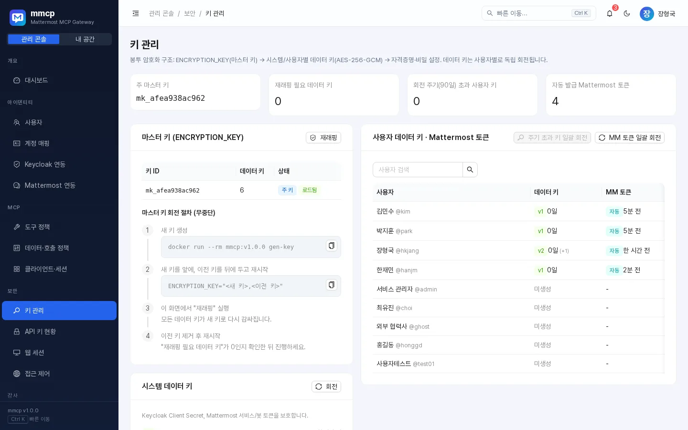
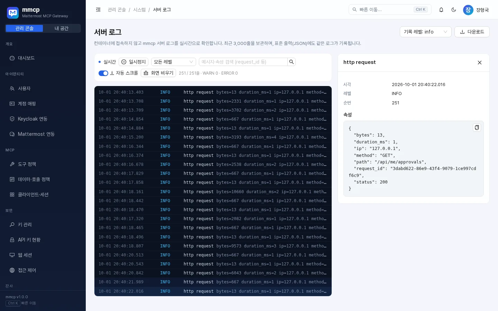
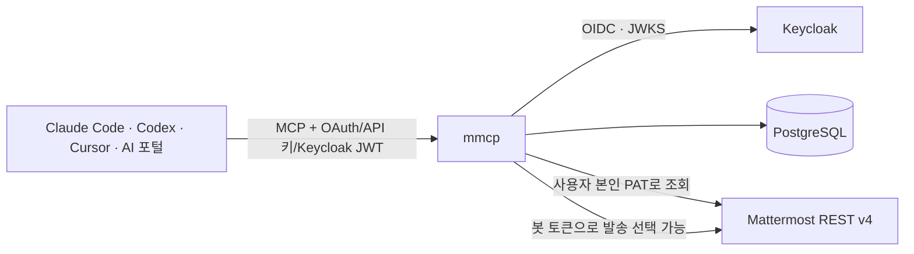

<p align="center">
  
</p>

<h1 align="center">mmcp — Mattermost MCP Gateway</h1>

<p align="center">
  Keycloak으로 로그인한 사용자 <b>본인의 Mattermost 권한</b>으로 Claude Code·Codex·Cursor·사내 AI 포털이<br/>
  채널을 검색하고, 스레드를 요약하고, 승인 후 DM을 보내게 하는 오프라인 사내망용 MCP 서버
</p>

<p align="center">
  <a href="https://github.com/hkjang/mmcp/releases/tag/v1.0.1"></a>
  
  
  
  
</p>

<p align="center">
  <a href="https://hkjang.github.io/mmcp/">홈페이지</a> ·
  <a href="docs/USER_GUIDE.md">사용자 가이드</a> ·
  <a href="docs/ADMIN_GUIDE.md">관리자 가이드</a> ·
  <a href="https://github.com/hkjang/mmcp/releases">다운로드</a>
</p>

<p align="center"></p>

## 왜 mmcp인가

Keycloak 액세스 토큰을 Mattermost REST API에 그대로 넘길 수는 없고, 공용 서비스 계정으로 조회하면 **사용자가 볼 수 없는 비공개 채널까지 AI가 보게 됩니다.** mmcp는 그 사이에서 다음을 책임집니다.

| 단계 | mmcp가 하는 일 |
| --- | --- |
| 인증 | Keycloak OIDC(사일런트 SSO) · MCP OAuth 2.1(DCR + PKCE) · Keycloak JWT 직접 검증 · 개인 API 키 |
| 식별 | `preferred_username`으로 최초 탐색 → **Keycloak `sub` ↔ Mattermost `user_id` 고정**. 계정 삭제·재생성·이름 가로채기는 자동 차단 |
| 권한 | 조회는 **항상 사용자 본인의 Mattermost 자격증명**으로. 그 위에 채널 유형·역할·호출 한도 정책을 한 겹 더 |
| 실행 | 쓰기 도구는 미리보기 → 사용자 동의 → `confirm_token`의 2단계 승인. DM 발송은 본인/봇/자동 중 선택 |
| 기록 | 모든 호출을 감사 로그로. 메시지 본문은 기본 미저장(질의 해시·건수만) |

## 30초 설치 (오프라인)

```bash
# 인터넷이 되는 곳에서 릴리스 파일을 받아 반입
sha256sum mmcp-v1.0.1.tar.gz   # 릴리스 노트의 SHA-256 값과 비교
docker load -i mmcp-v1.0.1.tar.gz            # → mmcp:v1.0.1

cat > .env <<'EOF'
POSTGRES_DSN=postgres://mmcp:secret@db:5432/mmcp?sslmode=disable
BOOTSTRAP_ADMIN=admin
BOOTSTRAP_ADMIN_PASSWORD=Change-Me-Now-2026!
ENCRYPTION_KEY=<docker run --rm mmcp:v1.0.1 gen-key 결과>
EOF
docker compose -f compose.offline.yml up -d   # http://<host>:8080
```

**환경변수는 이 4개가 전부입니다.** Keycloak, Mattermost, MCP 정책, 접근 제어 등 나머지는 모두 관리 콘솔에서 설정하고 PostgreSQL에 저장됩니다(비밀값은 암호화).

## AI 클라이언트 연결

```bash
claude mcp add --transport http mmcp https://mcp.company.co.kr/mcp   # OAuth: 브라우저에서 "허용" 한 번
```

```toml
# ~/.codex/config.toml
[mcp_servers.mmcp]
url = "https://mcp.company.co.kr/mcp"
bearer_token_env_var = "MMCP_API_KEY"   # 내 API 키 (mmcp_pk_…)
```

Cursor, VS Code, 사내 AI 포털(Keycloak 토큰 그대로) 설정은 [사용자 가이드](docs/USER_GUIDE.md)와 콘솔의 **MCP 연결 가이드** 화면에 있습니다.

## 주요 기능

- **MCP 도구 28종**: 내 정보·팀·채널·검색·스레드·최근/고정/미확인 메시지·첨부 파일, 메시지 작성·답글·수정·반응·파일 첨부, 채널 생성·멤버 추가, **DM·그룹 DM 발송/읽기/검색/답장/파일 DM**, 위험 도구(삭제·보관, 기본 비활성) + 공식 Mattermost MCP 호환 별칭(`dm`, `group_message`, `create_post`, `search_users`)
- **받는 사람 해석**: username·이메일·한글 이름(`김철수`) 모두 지원, 동명이인이면 후보를 돌려주고 임의 발송하지 않음
- **발신 계정**: 본인 명의 / 봇("장형국님의 요청으로 전송" + `props.requested_by`) / 자동. 사용자 비밀번호는 절대 받지 않음
- **키 관리**: 봉투 암호화(마스터 키 → 사용자별 데이터 키, AES-256-GCM + AAD), 개인 키 회전, 마스터 키 무중단 회전(재래핑), API 키 유예 회전, Mattermost 토큰 자동 발급·일괄 회전
- **콘솔**: 관리 콘솔 / 내 공간 분리, `Ctrl+K` 명령 팔레트(초성 검색), `G → 글자` 단축키, 실시간 서버 로그, 도구 실행기, 감사 로그 CSV, 백업·복원, 다크 모드, 모바일 대응
- **운영**: distroless 단일 이미지(약 36MB), 읽기 전용 루트 FS, `/api/health`·`/api/ready`·`/metrics`·OpenAPI

## 화면

| 계정 매핑 (충돌 자동 차단) | 도구 실행기 (승인 흐름) |
| --- | --- |
|  |  |
| **키 관리** | **실시간 서버 로그** |
|  |  |

더 많은 화면은 [홈페이지](https://hkjang.github.io/mmcp/#screens)에서 볼 수 있습니다.

## 아키텍처



## 개발

```bash
make test                       # Go 단위 테스트 + 프론트엔드 테스트
TEST_POSTGRES_DSN=postgres://... make test-integration   # PostgreSQL + 가짜 Mattermost 통합 테스트
make build                      # UI 빌드 → Go 바이너리에 임베드 → bin/mmcp
make package-offline            # release/mmcp-v1.0.1.tar.gz
```

로컬 E2E 환경(Mattermost preview + Keycloak + 데모 데이터)은 `scripts/dev/`의 스크립트로 만들 수 있습니다.

## 라이선스

MIT. 번들된 서드파티 구성요소는 [THIRD_PARTY_NOTICES.md](THIRD_PARTY_NOTICES.md)를 참고하세요.
